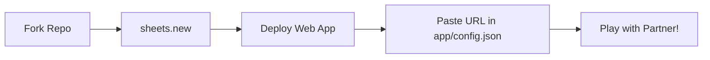

# 💖 Pookie - Turn-Based Couple's Mini-Game App

<p align="center">
  
  
  
  
</p>

> **"Because everyday love is made of little turns, playful moves, and shared laughter."**  
> **Pookie** is a room-based, turn-based mini-game app crafted for couples to connect, play, and spark conversations anywhere, anytime.

---

## 👨‍💻 Architecture & Lead Developer
- **Architect & Principal Developer:** [Soham Dalwadi](https://github.com/sohamdalwadi)
- **Official Repository:** [https://github.com/sohamdalwadi/Pookie](https://github.com/sohamdalwadi/Pookie)
- **Frontend / Game Engine:** Anti Gravity
- **Backend & Database:** Google Sheets + Google Apps Script (Zero-Cost Serverless REST API)

---

## 🎮 Launch Games

| Game | Format | Description | Specification |
| :--- | :---: | :--- | :--- |
| **❌⭕ Tic-Tac-Toe** | Turn-Based | The classic 3x3 showdown with delightful couple touches and animations. | [Read Spec](docs/games/TIC_TAC_TOE.md) |
| **🟦 Dots & Boxes** | Turn-Based | Tactical edge-connecting game where capturing a box grants an extra turn. | [Read Spec](docs/games/DOTS_AND_BOXES.md) |
| **💖 Couples Quiz** | Simultaneous | Blind icebreaker questions with simultaneous reveals to spark deep conversations. | [Read Spec](docs/games/COUPLES_QUIZ.md) |
| **✨ SoulSync** | Simultaneous | Freeform blind-matching bonding quiz with real-time mutual verdict scoring. | [Read Spec](docs/games/SOUL_SYNC.md) |

---

## 🌐 Web Client & GitHub Pages

Pookie is available directly in the browser across **laptops, desktops, and mobile devices**:
- **Zero Configuration:** Players never have to enter deployment keys or backend IDs. The permanent demo deployment key is automatically injected at build time from GitHub Actions repository secret `POOKIE_DEMO_DEPLOYMENT_ID`.
- **Responsive Experience:** Fullscreen mobile-touch layout (`100dvh`) with native Web Share API support + 3-column laptop dashboard with live QR code pairing for your partner.
- **Local Development:**
  ```bash
  cd web
  npm install
  npm run dev
  ```
  *(Vite will automatically load `POOKIE_DEMO_DEPLOYMENT_ID` from your `local.properties` for seamless local testing!)*


---

## 📚 Comprehensive Architecture & Engineering Documentation

All engineering blueprints have been mapped out prior to code implementation:

| Document | Description |
| :--- | :--- |
| 🚀 **[Quickstart & Setup Guide](docs/SETUP_GUIDE.md)** | Step-by-step 3-minute self-hosting guide for forkers with Mermaid diagrams. |
| 🛠️ **[Clasp CLI Developer Guide](docs/CLASP_CLI_GUIDE.md)** | Local development, pushing scripts, and webapp deployments via Google Clasp. |
| 🔐 **[Dynamic Binding & Security](docs/architecture/DYNAMIC_BINDING_AND_SECURITY.md)** | Zero-hardcoding architecture, container binding, and client config abstraction. |
| 📄 **[Master Technical Specification](docs/architecture/TECHNICAL_SPEC.md)** | End-to-end architectural design, schemas, API contracts, lifecycles, and FSM. |
| 🗄️ **[Database Schema Blueprint](docs/architecture/DATABASE_SCHEMA.md)** | Exact Google Sheets visual layout, columns, types, and single-cell JSON serialization. |
| 🌐 **[REST API Specification](docs/architecture/API_SPEC.md)** | Complete request/response contracts for `CREATE_ROOM`, `JOIN_ROOM`, `GET_STATE`, `MAKE_MOVE`, and `RESET_GAME`. |
| 🔄 **[State Machines & Polling](docs/architecture/STATE_MACHINES.md)** | Client FSM, turn handshakes, and 4-tier adaptive heartbeat engine to preserve battery and Google API quota. |
| 🧹 **[Auto-Cleanup & Cron](docs/architecture/CLEANUP_CRON.md)** | Pseudocode, 30-minute inactivity thresholds, and batch memory row cleanup. |
| 🤖 **[AI Quiz Architecture (Gemini Free)](docs/games/AI_QUIZ_ARCHITECTURE.md)** | Single-side Host API key generation, zero-friction sync, and dynamic couple prompts. |
| 🔒 **[Couple Profile & Zero-PII Privacy](docs/architecture/COUPLE_PROFILE_AND_PRIVACY.md)** | In-app nicknames, relation tags, dynamic chemistry scoring, and LLM privacy redaction. |
| 🎨 **[UI/UX Design Specification](docs/architecture/UI_UX_SPECIFICATION.md)** | Telegram Mini-App (EdChess) aesthetics, vector-first design, and dice randomizer. |
| 📐 **[Vector Icon System & Assets](docs/design/VECTOR_ICON_SYSTEM.md)** | Complete simple geometric SVG icon suite, Android VectorDrawables, and zero-emoji specs. |
| 🔑 **[Finding Your Deployment ID & URL](docs/architecture/BACKEND_ID_EXTRACTION_GUIDE.md)** | Visual guide on locating your Google Apps Script Deployment ID in browser or CLI. |
| ⚡ **[Game Mechanics, Reactions & Moods](docs/architecture/GAME_MECHANICS_AND_REACTIONS.md)** | Scoring rules, live floating reaction vectors, and dynamic relationship mood engine. |
| 📸 **[Couple Scrapbook & Memory Cards](docs/architecture/COUPLE_SCRAPBOOK_AND_SUMMARY.md)** | Date-night session recaps, custom superlatives, and exportable social cards. |
| 🎨 **[Game Animations & Physics Specs](docs/architecture/GAME_ANIMATIONS_SPECIFICATION.md)** | Spring physics, vector mark drawing, 3D card flips, and particle confetti systems. |
| 🎬 **[UI Screen Flow & Motion Transitions](docs/architecture/UI_TRANSITION_ARCHITECTURE.md)** | Complete 7-screen flow graph, shared element transitions, motion curves, and haptic audio specs. |
| 📱 **[In-App Backend Setup & OTA Updates](docs/architecture/IN_APP_BACKEND_SETUP_AND_OTA.md)** | Dynamic in-app backend linking, QR server sharing, and GitHub-powered OTA APK updates. |
| 🌿 **[Branching & Release Strategy](docs/BRANCHING_STRATEGY.md)** | Git-Flow hybrid strategy, `develop` testing builds, and `main` production release pipeline. |
| 🤖 **[CI/CD & Tag Release Guide](docs/CI_CD_RELEASE_GUIDE.md)** | Automated GitHub Actions compile checks and tag-based release pipeline. |
| 🗺️ **[Development Roadmap](docs/ROADMAP.md)** | Phased engineering timeline from planning through launch. |
| 🤝 **[Contributing with Antigravity](docs/CONTRIBUTING.md)** | Guide to adding new games and features using Antigravity AI agents without Android knowledge! |

---

## ⚡ 3-Minute Quickstart (Self-Hosting for Forkers)

Pookie is built with a **100% generic, zero-hardcoding architecture**. When you fork Pookie, you deploy your own private backend on your Google Drive at zero cost:



1. **Create your Google Sheet:** Go to [sheets.new](https://sheets.new) and open **Extensions > Apps Script**.
2. **Deploy as Web App:** Paste the backend script, run `bootstrapDatabase` once (auto-creates tabs & questions), and deploy as Web App (`Execute as: Me`, `Access: Anyone`).
3. **Configure your Client:**
   ```bash
   cp app/config.template.json app/config.json
   ```
   Paste your generated Web App URL into `app/config.json`:
   ```json
   {
     "POOKIE_API_URL": "https://script.google.com/macros/s/YOUR_DEPLOYMENT_ID/exec"
   }
   ```
4. **Compile & Play:** Your app now talks exclusively to your private Google Sheet database. `config.json` is ignored by Git to keep your endpoint private.

---

## 🌿 Branching Strategy & Development Builds

Pookie uses a dual-track release and development model:
* **`main` (Production):** Protected stable release branch. Official tagged releases (`v*`) build the production release APK.
* **`develop` (Development):** Continuous integration branch. Every push or merge into `develop` automatically compiles the code, executes test suites, and publishes an installable **Dev Testing APK** (`Pookie-dev-latest.apk`) to GitHub Releases.

### 📲 Download Latest Dev Build (For Testers)
Testers can install the newest development build directly on Android:
👉 **[Download Latest Dev Build (`Pookie-dev-latest.apk`)](https://github.com/sohamdalwadi/Pookie/releases/tag/dev-latest)**

---

## 🔒 Contribution Workflow
1. **Fork** the repository to your GitHub account.
2. Create a feature branch branching off **`develop`** (`git checkout -b feat/my-new-game`).
3. Build your feature or mini-game following Clean Architecture.
4. Push your branch and open a **Pull Request** targeting **`develop`**.
5. Automated CI runs all unit tests and syntax checks. Once merged into `develop`, a fresh testing APK is built automatically!
6. When a version milestone is reached, `develop` is merged into `main` and tagged for production release.

---

## 🌟 Why Antigravity for Contributions?
You don't need Android SDK or complex game engine experience to build games for Pookie!
Our repository contains an Antigravity custom skill in [`.agents/skills/pookie-game-dev/SKILL.md`](.agents/skills/pookie-game-dev/SKILL.md) and rules in [`.agents/rules/POOKIE_GUIDELINES.md`](.agents/rules/POOKIE_GUIDELINES.md).

Simply open this repository in Antigravity and prompt:
> *"Add a new couple's mini-game called 'Memory Flip Cards' following the pookie-game-dev skill."*

Antigravity will understand the board serialization, state machine, and API contracts to scaffold your game end-to-end.

---

## 👥 Contributors

Thanks to all the lovely people who contribute to Pookie! This section updates automatically whenever a new contributor's pull request is merged:

<p align="center">
  <a href="https://github.com/sohamdalwadi/Pookie/graphs/contributors">
    
  </a>
</p>

Want to see your avatar here? Check out our [Contributing Guide](docs/CONTRIBUTING.md) to add a mini-game or improve the architecture!

---

## 📜 License & Attribution

Copyright (c) 2026 **Soham Dalwadi** ([@sohamdalwadi](https://github.com/sohamdalwadi)).

- **Personal & Educational Use:** **Free** to use, enhance, modify, and play with your partner. All forks and distributions must retain credit to the original creator (**Soham Dalwadi**) with a link to [https://github.com/sohamdalwadi/Pookie](https://github.com/sohamdalwadi/Pookie).
- **Commercial Use:** Any commercial distribution, monetization, or embedding into paid products is strictly prohibited without prior written authorization. For commercial inquiries, contact:
  - **Email:** `crzy.pintu@gmail.com`
  - **Author:** Soham Dalwadi

See the full [LICENSE](LICENSE) file for complete terms.
