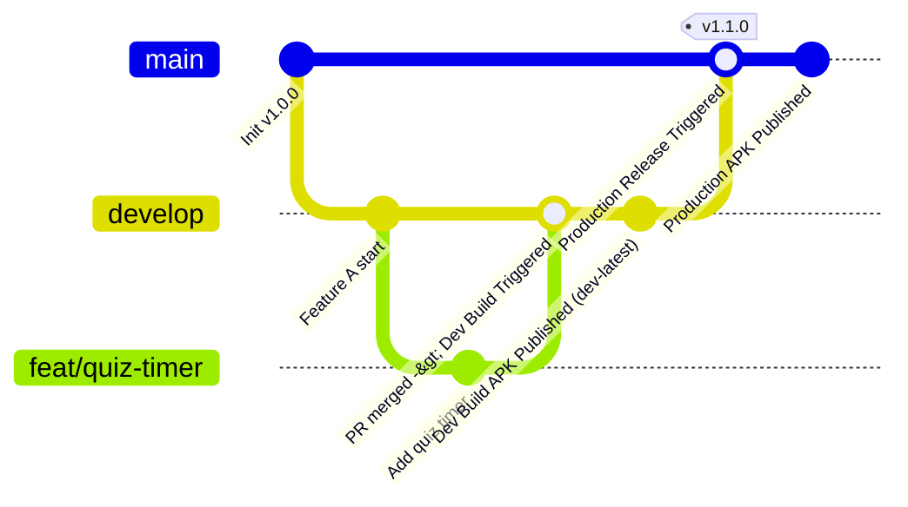

# 🌿 Pookie Git Branching & Release Strategy

**Author:** Soham Dalwadi  
**Role:** Principal Architect & Lead Developer  
**Status:** Active  

---

## 📌 Executive Summary

Pookie employs an agile **Git-Flow hybrid branching strategy** designed to ensure **production stability on `main`** while providing continuous, automated **development test builds on `develop`**.

* **`main` (Production):** Protected. Every release is strictly tagged (`v*`) and delivers a stable, production-ready APK.
* **`develop` (Development):** Primary working branch. Every push automatically generates an installable **Dev Testing APK** (`Pookie-dev-latest.apk`) accessible via GitHub Releases / Actions for testers.
* **Feature Branches (`feat/*`, `fix/*`):** Created from `develop` and merged back into `develop` via Pull Requests with mandatory CI validation.

---

## 🗺️ Branch Topology & Lifecycle



---

## 🏗️ Branch Definitions & Rules

| Branch | Purpose | Protection Rules | Triggered CI/CD Pipeline |
| :--- | :--- | :--- | :--- |
| **`main`** | Production releases | Requires PR approval, CI must pass. No direct force pushes. | **`release.yml`** (on tag `v*` or dispatch) |
| **`develop`** | Active development & integration | CI must pass before merging. | **`ci.yml`** + **`dev-build.yml`** (Dev APK generated) |
| **`feat/*`** | New features or mini-games | Branch off `develop`, PR into `develop`. | **`ci.yml`** (validation & unit tests) |
| **`fix/*`** | Bug fixes & improvements | Branch off `develop`, PR into `develop`. | **`ci.yml`** (validation & unit tests) |
| **`hotfix/*`** | Critical production patches | Branch off `main`, merge to `main` & `develop`. | **`ci.yml`** + **`release.yml`** |

---

## 🚀 Automated CI/CD Pipelines

### 1. Development Build Pipeline (`.github/workflows/dev-build.yml`)
* **Trigger:** Pushes to `develop` branch or manual `workflow_dispatch`.
* **Jobs:**
  1. Checks out repository and sets up JDK 17 with Gradle cache.
  2. Runs unit tests (`gradlew testDebugUnitTest`).
  3. Compiles and packages debug APK (`gradlew assembleDebug`).
  4. Generates two APK outputs:
     * `Pookie-dev-latest.apk`: Rolling file always pointing to the newest dev build.
     * `Pookie-dev-<short_sha>.apk`: Commit-pinned immutable build.
  5. Uploads artifacts to GitHub Actions run (14-day retention).
  6. Automatically updates the **GitHub Pre-Release (`dev-latest`)** so testers can download and install directly on their phones.

### 2. Production Release Pipeline (`.github/workflows/release.yml`)
* **Trigger:** Git tags matching `v*` (e.g. `git tag -a v1.0.0 -m "Release v1.0.0" && git push origin v1.0.0`).
* **Jobs:**
  1. Validates repository integrity and executes unit test suite.
  2. Builds official APK: `Pookie-vX.Y.Z.apk`.
  3. Uploads 30-day artifact.
  4. Publishes official GitHub Release with auto-generated changelog notes.

### 3. Continuous Integration Verification (`.github/workflows/ci.yml`)
* **Trigger:** PRs targeting `main` or `develop`, and pushes to `main` or `develop`.
* **Jobs:**
  1. Validates backend JavaScript syntax (`node --check backend/src/Code.js`).
  2. Verifies JSON configuration templates.
  3. Compiles Kotlin code (`gradlew compileDebugKotlin`).
  4. Runs all domain engine unit tests (`gradlew testDebugUnitTest`).

---

## 📲 Tester Guide: Installing Development Builds

Internal testers can install and test new features immediately after any push to `develop`:

1. **Direct Download Link:**  
   Navigate on your Android phone to:  
   👉 **`https://github.com/sohamdalwadi/Pookie/releases/tag/dev-latest`**  
   Tap on [`Pookie-dev-latest.apk`](https://github.com/sohamdalwadi/Pookie/releases/download/dev-latest/Pookie-dev-latest.apk) to download.

2. **Installation:**  
   * Open the downloaded APK.
   * If prompted, toggle **Allow from this source** in Android Settings.
   * Tap **Install** or **Update**.

3. **Connecting Backend:**  
   * Launch Pookie.
   * On the Backend Setup screen, paste your Google Apps Script Deployment ID or URL.
   * Tap **Test & Save Backend** to enter the Arena!

---

## 🔄 Daily Workflow for Developers

### Developing a New Feature:
```bash
# 1. Update your local develop branch
git checkout develop
git pull origin develop

# 2. Create your feature branch
git checkout -b feat/my-new-minigame

# 3. Make changes, run local compilation check
.\gradlew.bat compileDebugKotlin
.\gradlew.bat testDebugUnitTest

# 4. Commit and push feature branch
git add .
git commit -m "feat(game): add new mini-game engine"
git push -u origin feat/my-new-minigame

# 5. Open a Pull Request targeting 'develop'
# Once merged into 'develop', GitHub Actions automatically builds and publishes the new Dev APK!
```

### Promoting `develop` to a Production Release:
```bash
# 1. Ensure develop is fully tested
git checkout main
git pull origin main
git merge develop --no-ff -m "chore(release): merge develop for v1.1.0"

# 2. Tag the release
git tag -a v1.1.0 -m "Release v1.1.0 - New Mini-Games & Reactions"

# 3. Push to GitHub
git push origin main
git push origin v1.1.0

# GitHub Actions will automatically compile, test, and release Pookie-v1.1.0.apk!
```
