# 🚀 CI/CD & Automated Tag Release Guide

**System:** Pookie Automated Release Pipeline  
**CI/CD Tool:** GitHub Actions  

---

## 📌 Architecture Overview

Pookie utilizes GitHub Actions to automate code validation on every pull request and compile release artifacts whenever a new Git version tag is pushed:

```mermaid
flowchart TD
    subgraph Pull Request Flow
        PR[Developer opens PR to main] --> Lint[Validate Spec & Config JSON]
        Lint --> Compile[Run Gradle Build / Test]
        Compile --> Status[Report Checkmark on PR]
    end

    subgraph Tagged Release Flow
        Tag[Maintainer pushes Git tag 'v*'] --> Checkout[Checkout repo & tags]
        Checkout --> SetupJDK[Set up Java JDK 17]
        SetupJDK --> Assemble[Run gradlew assembleRelease]
        Assemble --> GenNotes[Auto-generate Changelog from Commits]
        GenNotes --> Publish[Publish GitHub Release + Attach APK]
    end
```



---

## 1. Automated PR Validation Workflow (`.github/workflows/ci.yml`)
Whenever a contributor opens a pull request against `main`:
1. GitHub Actions spins up an `ubuntu-latest` runner.
2. Verifies JSON configuration templates.
3. Tests Gradle compilation.
4. Prevents regressions before any PR can be merged into `main`.

---

## 2. Pushing a Version Tag to Publish a Release (`.github/workflows/release.yml`)

Releases are published automatically via Git tags using semantic versioning (`vMAJOR.MINOR.PATCH`).

### Step-by-Step Release Command:
```bash
# 1. Ensure you are on the latest main branch
git checkout main
git pull origin main

# 2. Create an annotated git tag
git tag -a v1.0.0 -m "Release v1.0.0: Launching Tic-Tac-Toe, Dots & Boxes, and Couples Quiz"

# 3. Push tag to GitHub
git push origin v1.0.0
```

### What Happens Automatically:
1. GitHub Actions detects the tag matching pattern `v*`.
2. Triggers the job `build-and-release`.
3. Runs Gradle packaging.
4. Automatically calculates all commits between the previous tag and this tag to generate release notes.
5. Publishes a GitHub Release under `https://github.com/sohamdalwadi/Pookie/releases` and attaches compiled binaries.
