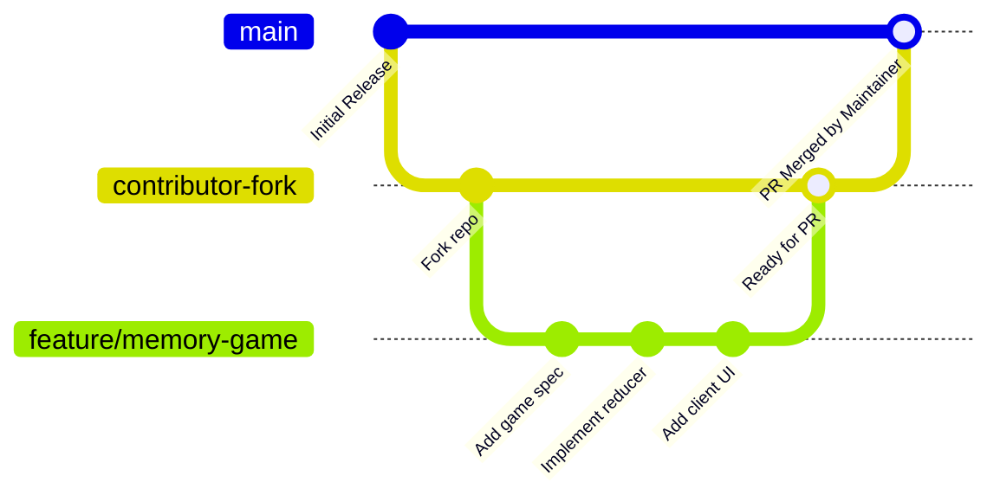

# 🤝 Contributing to Pookie

Thank you for your interest in contributing to **Pookie**! We want to make couple gaming joyful, accessible, and delightful.

---

## 🔒 Protected Branch Model
The `main` branch of [https://github.com/sohamdalwadi/Pookie](https://github.com/sohamdalwadi/Pookie) is **strictly protected**.
- Direct pushes to `main` are disabled.
- All code changes, new mini-games, and bugfixes must come through a **Fork & Pull Request (PR)**.
- Automated CI workflows run validation tests on every PR before merge.

---

## 🔄 Fork & PR Git Workflow



### Step-by-Step Instructions:

1. **Fork the Repository:**
   Click the **Fork** button on top of [https://github.com/sohamdalwadi/Pookie](https://github.com/sohamdalwadi/Pookie) to create your personal copy (`your-username/Pookie`).

2. **Clone your Fork locally:**
   ```bash
   git clone https://github.com/<your-username>/Pookie.git
   cd Pookie
   ```

3. **Add Upstream Remote:**
   ```bash
   git remote add upstream https://github.com/sohamdalwadi/Pookie.git
   git fetch upstream
   ```

4. **Create a Feature Branch:**
   Always branch off `upstream/main`:
   ```bash
   git checkout -b feature/awesome-new-mini-game
   ```

5. **Develop with Antigravity (No Android Experience Required!):**
   Open the repository in Antigravity. Use the built-in skill [`.agents/skills/pookie-game-dev/SKILL.md`](../.agents/skills/pookie-game-dev/SKILL.md):
   > *"Using the pookie-game-dev skill, please help me build a new turn-based mini-game called 'Memory Cards'."*

6. **Commit & Push:**
   Use semantic commit messages:
   ```bash
   git add .
   git commit -m "feat(game): add Memory Cards mini-game contract and views"
   git push origin feature/awesome-new-mini-game
   ```

7. **Open a Pull Request:**
   Go to GitHub and click **Compare & pull request** against `sohamdalwadi/Pookie:main`. Fill out the PR template explaining the game mechanics or fixes.

---

## 📜 Licensing & Attribution Rules
- **Personal Enhancements & Open Contributions:** Completely free and welcomed under our source-available terms.
- **Attribution:** All forks and derivatives must preserve attribution to the original author and architect: **Soham Dalwadi**.
- **Commercial Use:** If you intend to use or monetize Pookie or derivative works commercially, please contact **Soham Dalwadi** at `crzy.pintu@gmail.com`.
