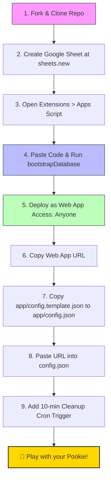
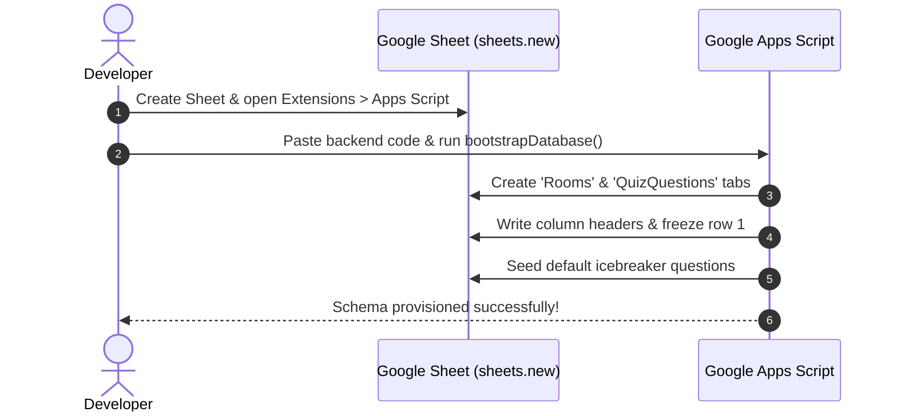
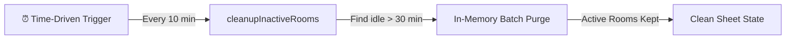

# 🚀 Pookie Quickstart & Setup Guide

**Welcome to Pookie!** Follow this 3-minute guide to spin up your own private couple's game server and connect the client.

---

## 📋 Architectural Setup Flow



---

## Step 1: Clone or Fork the Repo
```bash
git clone https://github.com/sohamdalwadi/Pookie.git
cd Pookie
```

---

## Step 2: Create Your Google Sheet Backend (Zero Cost)

1. Open your browser and navigate to [sheets.new](https://sheets.new) (creates a brand new Google Spreadsheet in your personal Google Drive).
2. Name your sheet: `Pookie Database`.
3. In the top menu bar, click **Extensions** > **Apps Script**.
4. Replace the empty `myFunction` with the backend code from `backend/src/Code.js`.
5. Run the function `bootstrapDatabase` once by selecting it from the toolbar dropdown and clicking **Run**:
   - Google will request authorization to manage your sheet. Grant access.
   - The script self-bootstraps: it automatically creates the `Rooms` and `QuizQuestions` sheets, formats columns, and populates starter questions!



---

## Step 3: Deploy as a Web App

1. In the Apps Script editor, click the blue **Deploy** button (top right) > **New deployment**.
2. Click the gear icon ⚙️ next to *"Select type"* and choose **Web app**.
3. Configure deployment settings:
   - **Description:** `Pookie REST API v1`
   - **Execute as:** `Me (your-email@gmail.com)`
   - **Who has access:** `Anyone` *(Crucial: allows client communication without OAuth login barriers)*
4. Click **Deploy**.
5. Copy the generated **Web App URL** (e.g. `https://script.google.com/macros/s/AKfycb.../exec`).

---

## Step 4: Configure the Client

1. In your local repository clone, copy the configuration template:
   ```bash
   cp app/config.template.json app/config.json
   ```
2. Open `app/config.json`:
   ```json
   {
     "POOKIE_API_URL": "https://script.google.com/macros/s/YOUR_ACTUAL_DEPLOYMENT_ID/exec",
     "POLLING_INTERVAL_ACTIVE_MS": 2000,
     "POLLING_INTERVAL_IDLE_MS": 4000,
     "ENABLE_DEBUG_LOGS": true
   }
   ```
3. Paste your unique Web App URL into `"POOKIE_API_URL"`.
4. Save the file. `config.json` is ignored by Git, ensuring your personal server URL remains private.

---

## Step 5: Setup the Auto-Cleanup Cron Trigger

To automatically purge inactive sessions and prevent database bloat, configure the time-driven cron trigger:



1. In your Apps Script editor, click the **Triggers** icon ⏰ (alarm clock on the left sidebar).
2. Click **+ Add Trigger** (bottom right).
3. Set the following options:
   - **Choose which function to run:** `cleanupInactiveRooms`
   - **Select event source:** `Time-driven`
   - **Select type of time based trigger:** `Minutes timer`
   - **Select minute interval:** `Every 10 minutes`
4. Click **Save**.

Your private, self-hosted, serverless couple's game backend is now completely operational!
