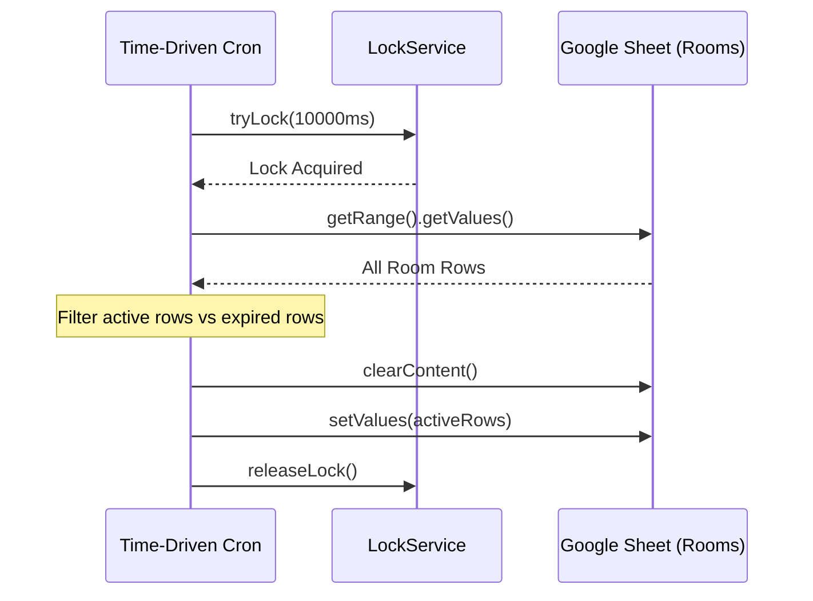

# 🧹 Server-Side Lifecycle & Auto-Cleanup Cron

**Author:** Soham Dalwadi  
**Role:** Principal Architect  
**Backend:** Google Apps Script Time-Driven Triggers  

---

## 📌 Problem Statement
Without auto-cleanup, a Google Sheet acting as a database accumulates dead rooms indefinitely. Over time:
- Sheet row counts grow past Google Sheets performant limits (> 10,000 rows causes noticeable latency in `SpreadsheetApp`).
- Room codes may experience collisions.
- Search operations (`getValues()`) take longer, increasing execution times toward the 6-minute GAS limit.

---

## 1. Trigger Configuration
- **Function:** `cleanupInactiveRooms`
- **Trigger Type:** Time-driven
- **Frequency:** Every 10 to 15 minutes
- **Locking:** ScriptLock (`LockService.getScriptLock()`) with a 10-second acquisition timeout.

---

## 2. Inactivity Threshold Rules

| Room Status | Inactivity Threshold | Action Taken |
|:---|:---:|:---|
| `WAITING_FOR_PARTNER` | 15 minutes without join | Deleted |
| `PLAYING` | 30 minutes without a move | Marked `ABANDONED`, then purged |
| `FINISHED` | 15 minutes without rematch | Deleted |
| `ABANDONED` | 10 minutes past abandonment | Deleted |

---

## 3. High-Efficiency In-Memory Batch Deletion

Instead of running slow individual `sheet.deleteRow(index)` calls inside a loop (which causes index skew and multiple HTTP RPC round-trips to Google's backend), we load the entire sheet into memory, filter it, clear the sheet, and write back the active rows in a single batch operation.

