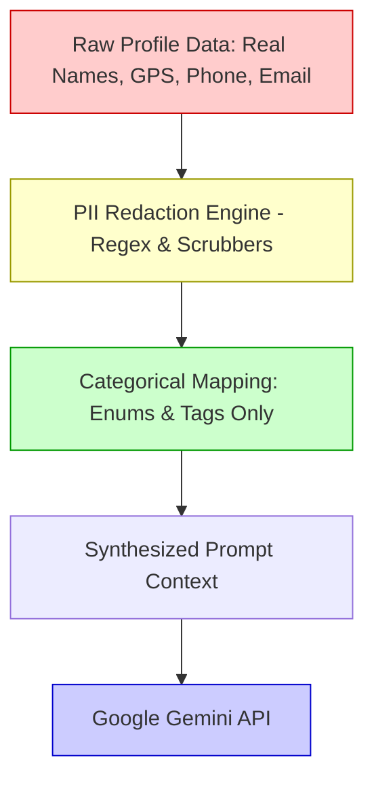

# 🔒 Couple Profile, Relationship Tags & Zero-PII LLM Privacy Architecture

**Author:** Soham Dalwadi  
**Role:** Principal Architect  
**Project:** Pookie  

---

## 📌 Executive Summary
To make the AI quiz and mini-game prompts deeply relatable, Pookie introduces an in-app **Couple Profile & Chemistry Engine**. 

While personalization requires context (e.g. relationship stage, humor style, pet ownership), **user privacy is paramount**. Pookie implements a **Zero-PII (Personally Identifiable Information) Sanitization Pipeline** to ensure that real names, private contact info, locations, and sensitive data are strictly quarantined locally on the device and NEVER transmitted to the LLM (Google Gemini) or Google Sheets.

---

## 1. Couple Profile Schema (Client-Side Model)

Stored locally in client secure storage (`SharedPreferences` on Android / LocalStorage in Web):

```typescript
interface CoupleProfile {
  // Local Identifiers (Never sent to LLM)
  id: string; // UUIDv4
  
  // Nicknames & Pronouns (Used safely for question phrasing)
  player1: {
    nickname: string;    // e.g. "Bubba"
    pronoun: 'HE_HIM' | 'SHE_HER' | 'THEY_THEM';
  };
  player2: {
    nickname: string;    // e.g. "Pookie"
    pronoun: 'HE_HIM' | 'SHE_HER' | 'THEY_THEM';
  };

  // Relationship Demographics (Categorical Enums only)
  relationshipType: 'DATING' | 'ENGAGED' | 'MARRIED' | 'LONG_DISTANCE' | 'JUST_TALKING' | 'BEST_FRIENDS';
  durationTier: 'LESS_THAN_6_MONTHS' | '6_TO_12_MONTHS' | '1_TO_3_YEARS' | '3_TO_5_YEARS' | '5_PLUS_YEARS';

  // Lifestyle & Humor Vibe Tags
  vibeTags: Array<
    | 'FOODIES'           // Obsessed with good food & late night snacks
    | 'TRAVEL_BUGS'       // Road trips, wanderlust, packing drama
    | 'PET_PARENTS'       // Dogs/cats reign supreme in the house
    | 'GAMERS'            // Competitive, cozy coop games
    | 'COFFEE_ADDICTS'    // Morning fuel ritual
    | 'HOMEBODIES'        // Cozy blankets & binge-watching
    | 'FITNESS_BUDDIES'   // Gym or outdoor workouts
    | 'CHAOTIC_ENERGY'    // Goofy banter, playful pranks
    | 'ROMANTIC_SOFTIES'  // Cuddles, love letters, sunset dates
  >;

  // Self-Learning Dynamics (Computed over time from game matches)
  chemistryScore: {
    telepathyIndex: number;     // % of Quiz questions where answers matched (0 - 100)
    banterLevel: number;        // Frequency of playful draws / rivalries
    totalGamesPlayed: number;
    unlockedBadges: string[];   // e.g. ["SOULMATE_FOODIES", "TICTAC_RIVALS"]
  };
}
```

---

## 2. Zero-PII Sanitization & Redaction Pipeline

Before any prompt is dispatched to Google Gemini, the **Privacy Sanitizer Engine** converts raw user profile data into a generic, safe semantic context:



### The Strict Privacy Rules:
1. **No Real Names:** Real names are NEVER prompted. Only sanitized, short nicknames (e.g., "Pookie" & "Bubba") or generic labels ("Partner A" & "Partner B") are used.
2. **Regex PII Blocker:** Any custom topic entered by the user is passed through client-side regex scrubbers to block:
   - Email addresses (`[a-zA-Z0-9._%+-]+@[a-zA-Z0-9.-]+\.[a-zA-Z]{2,}`)
   - Phone numbers / credit cards / coordinates
   - Street addresses
3. **No Private Secrets or Surnames:** Custom prompts are sanitized to remove words like *"Avenue"*, *"Street"*, *"SSN"*, *"Password"*, etc.
4. **Local Computation:** Dynamic chemistry badges and scores are calculated **locally** on the device.

---

## 3. Safe Prompt Synthesizer Example

Here is how the client formats the sanitized prompt sent to Gemini:

```json
{
  "contents": [{
    "parts": [{
      "text": "You are a warm, humorous couples quiz host. Generate 5 multiple-choice questions for a couple with these attributes:\n- Relationship: Married (1 to 3 years)\n- Nicknames: 'Bubba' (He/Him) and 'Pookie' (She/Her)\n- Dynamic: Playful banter and high food affinity\n- Tags: ['FOODIES', 'PET_PARENTS', 'CHAOTIC_ENERGY']\n\nRULES:\n1. Keep it lighthearted, relatable, and fun.\n2. Do NOT mention any real names, locations, or sensitive topics.\n3. Return ONLY a JSON array with: questionId, category, questionText, optionA, optionB, optionC, optionD."
    }]
  }],
  "generationConfig": {
    "responseMimeType": "application/json"
  }
}
```

### Sample AI-Generated Output:
```json
[
  {
    "questionId": "Q_AI_01",
    "category": "FOODIES",
    "questionText": "It's 11 PM on a Sunday. Who is more likely to convince the other to order midnight fries?",
    "options": {
      "A": "Definitely Bubba",
      "B": "100% Pookie",
      "C": "The pet made us do it",
      "D": "Neither, we already raided the pantry"
    }
  },
  {
    "questionId": "Q_AI_02",
    "category": "PET_PARENTS",
    "questionText": "Who uses the silliest high-pitched baby voice when talking to our pet?",
    "options": {
      "A": "Bubba without shame",
      "B": "Pookie completely",
      "C": "Both of us in harmony",
      "D": "We pretend we don't, but we do"
    }
  }
]
```

---

## 4. Self-Learning Relationship Tags & Badges

As the couple plays games across different sessions, the app unlocks **Relationship Chemistry Badges**:

| Metric | Condition | Unlocked Badge | Impact on AI Prompts |
| :--- | :--- | :--- | :--- |
| **Telepathy Rate** | > 80% matches in Quiz | `🧠 Brainwave Twins` | Generates deeper, nuanced questions. |
| **Food Category** | 100% match on food questions | `🍕 Soulmate Foodies` | Adds delicious snack-related dilemma questions. |
| **Dots & Boxes** | > 5 rematches in one session | `⚔️ Playful Rivals` | Generates witty "who is more stubborn" banter questions. |
| **Long Streak** | Played 7 days in a row | `🔥 Unstoppable Duo` | Acknowledges milestones with anniversary-style questions. |

All badge data is stored strictly in client local storage, building a warm, growing couple memory bank that belongs exclusively to the couple!
