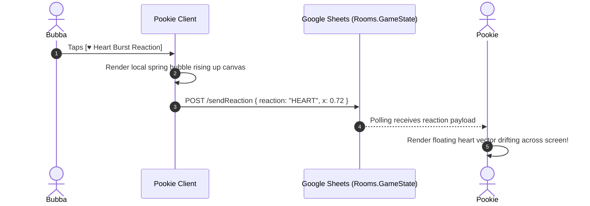
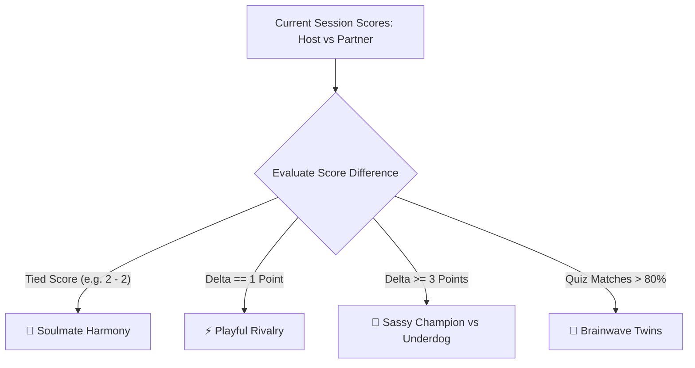

# ⚡ Game Mechanics, Scoring, Live Reactions & Dynamic Moods

**Author:** Soham Dalwadi  
**Role:** Principal Architect & Game Designer  
**Project:** Pookie  

---

## 📌 Executive Summary
Couple games should never feel sterile or purely mathematical. Pookie integrates **tactile scoring**, **real-time floating reaction pops**, and **dynamic relationship mood states** that react to how the couple is playing.

---

## 1. Game Mechanics & Scoring Engine

| Mini-Game | Turn Structure | Win / Round Scoring | Session Aggregate |
| :--- | :--- | :--- | :--- |
| **❌⭕ Tic-Tac-Toe** | Strict Alternating | **Win:** +1 Match Point.<br>**Draw:** 0 points, counts toward Banter Index. | Best of 3 / Best of 5 series tracking. |
| **🟦 Dots & Boxes** | Turn-based with **Consecutive Turn Reward** | Each captured 1x1 box = **+1 Territory Point**.<br>Player with most boxes wins match (+1 Win Point). | Lifetime boxes captured tally. |
| **💖 Couples Quiz** | Simultaneous Blind Input | **Matching Answers:** +2 Telepathy Points.<br>**Different Answers:** +1 Banter Point (Unlocks discussion prompt). | Telepathy % Rate (Total Matches / Total Questions). |

---

## 2. In-Game Live Reaction Pops (Real-Time Floating Vectors)

During active matches, either partner can send instant **Floating Live Reactions** to celebrate, tease, or react to an unexpected move!

### Reaction Drawer Layout:
Tapping the subtle reaction tray at the bottom-right opens a sleek 6-reaction popover:

```
┌──────────────────────────────────────────────┐
│  [♥ Heart Burst]    [⚡ Thunderbolt Tease]   │
│  [🎉 Party Popper]  [🤔 Deep Ponder]         │
│  [👑 Crown Flex]    [🏳️ White Flag Truce]     │
└──────────────────────────────────────────────┘
```



### Motion Physics of Reaction Pops:
- **Trajectory:** Reactions spawn near the player's avatar card and float upward with gentle sinusoidal horizontal drift (`sin(t * frequency) * amplitude`).
- **Scale:** Pops in at `scale: 0.2`, expands to `scale: 1.2` with spring bounce, floats for 2.2 seconds, and fades out (`opacity: 1.0 -> 0.0`).
- **Sound & Haptics:** Generates a light pop sound and micro-vibration on both phones.

---

## 3. Dynamic Relationship Mood Engine

Based on match scores and round histories, Pookie dynamically shifts the room's **Ambient Mood**:



### Mood States & Visual Manifestations:

#### 1. 💖 Soulmate Harmony (Scores are Evenly Tied)
- **Trigger:** Scores are tied after at least 2 rounds (e.g. `1 - 1` or `2 - 2`).
- **Visuals:** Warm rose-gold ambient lighting along screen edges.
- **Micro-Copy:** *"Evenly matched love. Neither wants to hurt the other's feelings!"*
- **Reaction Pop Multiplier:** Hearts trigger a twin-particle burst.

#### 2. ⚡ Playful Rivalry (1-Point Spread)
- **Trigger:** Score difference is exactly 1 (e.g. `2 - 1` or `3 - 2`).
- **Visuals:** Electric violet accent borders with subtle pulsing turn indicators.
- **Micro-Copy:** *"The competition is heating up! Who gets bragging rights?"*
- **Reactions:** Teasing lightning and crown vectors animate with extra bounce.

#### 3. 👑 Sassy Champion vs. The Underdog (3+ Point Lead)
- **Trigger:** One partner leads by 3 or more wins (e.g. `4 - 1`).
- **Visuals:**
  - Leading player's avatar receives a subtle golden crown vector icon.
  - Trailing player receives an *"Underdog Comeback Mode"* neon badge.
- **Micro-Copy:** *"Warning: A massive comeback is brewing. Don't get comfortable!"*
- **Fun Mechanic:** If the underdog wins the next match, the game triggers a special *"Giant Slayer"* celebration particle explosion!

#### 4. 🧠 Brainwave Twins (Couples Quiz Telepathy)
- **Trigger:** Both partners choose the exact same answers in 4 or more consecutive quiz questions.
- **Visuals:** Glowing mint-emerald card flip animations.
- **Micro-Copy:** *"Are you two reading each other's minds?!"*
