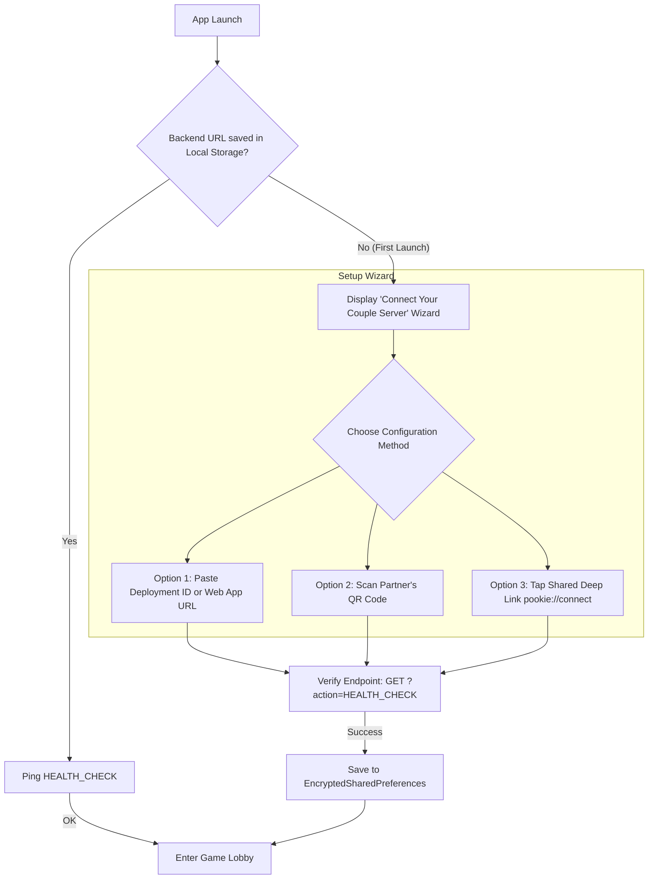
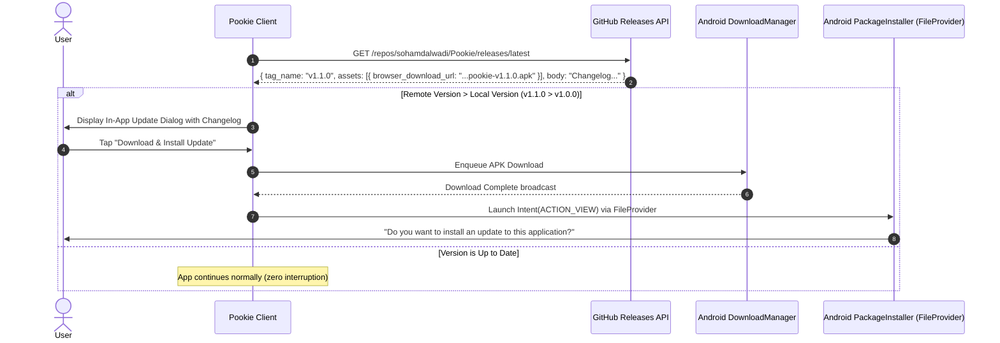

# 📱 In-App Dynamic Backend Linking & GitHub OTA Updates Architecture

**Author:** Soham Dalwadi  
**Role:** Principal Architect  
**Project:** Pookie  

---

## 📌 Executive Summary
In an open-source game distributed via GitHub Releases, **two critical challenges arise:**
1. **The Pre-Compiled APK Problem:** If a user downloads a pre-built APK from GitHub Releases, how do they connect it to their own private Google Sheet backend without having to recompile the source code?
2. **The App Update Problem:** Without Google Play Store or App Store publishing, how do users receive bug fixes, new mini-games, and performance improvements?

Pookie solves both challenges through:
1. **In-App Dynamic Backend Linker & QR Pairing Engine.**
2. **GitHub-Powered In-App Over-The-Air (OTA) Auto-Updater.**

---

## 1. In-App Dynamic Backend Linker

When someone downloads and installs a generic Pookie APK, the app does not fail or crash. Instead, it guides the couple through a 60-second setup.



### 1.1 In-App Input Modes
1. **Short Deployment ID Input:**
   Users don't even need to paste the long `https://script.google.com/macros/s/.../exec` URL. They can simply paste their **Deployment ID** (`AKfycb0123456789_EXAMPLE_ID...`).
   The app automatically expands it:
   ```kotlin
   fun formatDeploymentUrl(input: String): String {
       val trimmed = input.trim()
       return if (trimmed.startsWith("http://") || trimmed.startsWith("https://")) {
           trimmed
       } else {
           "https://script.google.com/macros/s/$trimmed/exec"
       }
   }
   ```

2. **Host-to-Partner QR Code & Deep Link Sharing:**
   - Once the Host configures the backend, they tap:  
     `[Share Server Config with Partner Vector]`
   - The app generates an instant QR code containing:  
     `pookie://connect?url=https%3A%2F%2Fscript.google.com%2F...`
   - Partner opens Pookie, taps *"Scan Partner's QR"*, and their app is instantly connected to the same backend with zero typing!
   - Alternatively, Host can send a deep link via WhatsApp or Telegram.

---

## 2. GitHub-Powered Over-The-Air (OTA) Updates

Pookie connects directly to its own GitHub repository to check for updates, download new APK releases, and trigger installation without external app store dependencies.

### 2.0 Branch-Isolated Dual-Channel OTA Architecture
To prevent version collisions and accidental downgrades between ongoing development and official production releases, Pookie implements isolated release channels:

| Channel | Source Branch | Build-Time `OTA_CHANNEL` | Target GitHub API Endpoint | Rolling Tag |
| :--- | :--- | :--- | :--- | :--- |
| **DEVELOP** | `develop` | `DEVELOP` | `.../releases/tags/dev-latest` | `dev-latest` |
| **PRODUCTION** | `main` | `PRODUCTION` | `.../releases/latest` | `v*` (SemVer tags) |

- **Build-Time Channel Injection (`app/build.gradle`):**
  - Gradle detects the current branch via `GITHUB_REF_NAME` (in CI/CD) or local git (`git rev-parse --abbrev-ref HEAD`).
  - Injects `BuildConfig.OTA_CHANNEL` and `BuildConfig.OTA_UPDATE_URL` directly into the compiled bytecode.
- **Independent Version Tracking:**
  - `develop` builds dynamically calculate versions starting from `0.0.0` or the last tag + commit count (e.g. `0.0.28`).
  - `main` builds track strict SemVer release tags (`v1.0.0`, `v1.1.0`).
  - Neither channel can see, overwrite, or prompt updates from the other channel.
- **Latest Tag Asset Replacement:**
  - In CI/CD (`.github/workflows/dev-build.yml`), prior to uploading the new build to the `dev-latest` tag, existing `.apk` assets are purged via `gh release delete-asset`.
  - The latest APK is uploaded as both `Pookie-dev-latest.apk` and `Pookie-v<version>.apk`.



### 2.1 GitHub Update Checker Logic (Kotlin Specification)

```kotlin
class PookieUpdateManager(private val context: Context) {

    private val GITHUB_REPO_API = "https://api.github.com/repos/sohamdalwadi/Pookie/releases/latest"

    fun checkForUpdates(onUpdateAvailable: (version: String, changelog: String, apkUrl: String) -> Unit) {
        val currentVersion = BuildConfig.VERSION_NAME // e.g. "1.0.0"

        // Perform lightweight async HTTP GET
        val request = Request.Builder()
            .url(GITHUB_REPO_API)
            .header("Accept", "application/vnd.github.v3+json")
            .build()

        client.newCall(request).enqueue(object : Callback {
            override fun onResponse(call: Call, response: Response) {
                response.body?.string()?.let { jsonStr ->
                    val release = JSONObject(jsonStr)
                    val latestTag = release.getString("tag_name").removePrefix("v") // "1.1.0"
                    val changelog = release.optString("body", "Performance improvements & new mini-games.")

                    if (isVersionNewer(latestTag, currentVersion)) {
                        val assets = release.getJSONArray("assets")
                        for (i in 0 until assets.length()) {
                            val asset = assets.getJSONObject(i)
                            if (asset.getString("name").endsWith(".apk")) {
                                val apkUrl = asset.getString("browser_download_url")
                                onUpdateAvailable(latestTag, changelog, apkUrl)
                                break
                            }
                        }
                    }
                }
            }
            override fun onFailure(call: Call, e: IOException) {
                // Silently fallback if offline
            }
        })
    }

    private fun isVersionNewer(remote: String, local: String): Boolean {
        val remoteParts = remote.split(".").map { it.toIntOrNull() ?: 0 }
        val localParts = local.split(".").map { it.toIntOrNull() ?: 0 }
        for (i in 0 until maxOf(remoteParts.size, localParts.size)) {
            val r = remoteParts.getOrElse(i) { 0 }
            val l = localParts.getOrElse(i) { 0 }
            if (r > l) return true
            if (r < l) return false
        }
        return false
    }
}
```

### 2.2 Security & Integrity Protections
1. **FileProvider Sandbox:** APKs are downloaded into app-private cache storage (`context.getExternalFilesDir(Environment.DIRECTORY_DOWNLOADS)`) and shared using secure Android `FileProvider`.
2. **User Consent:** The app never installs silently; it delegates to the Android OS package installer so the user explicitly approves the upgrade.
3. **Rollback Safety:** If a download fails or connection drops, Android `DownloadManager` handles retry and resume seamlessly.
