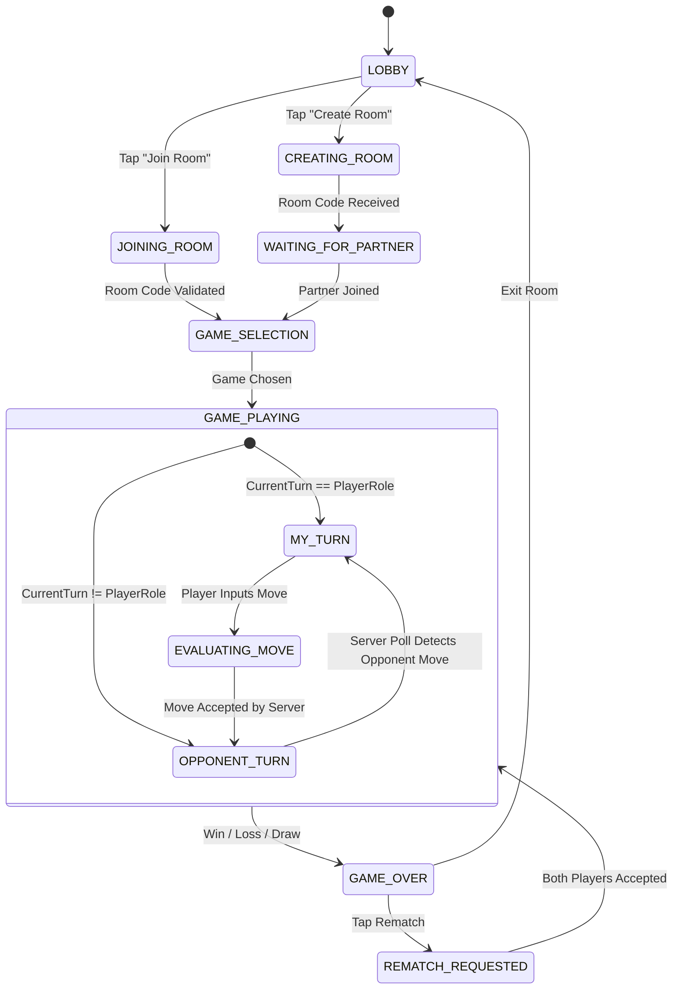
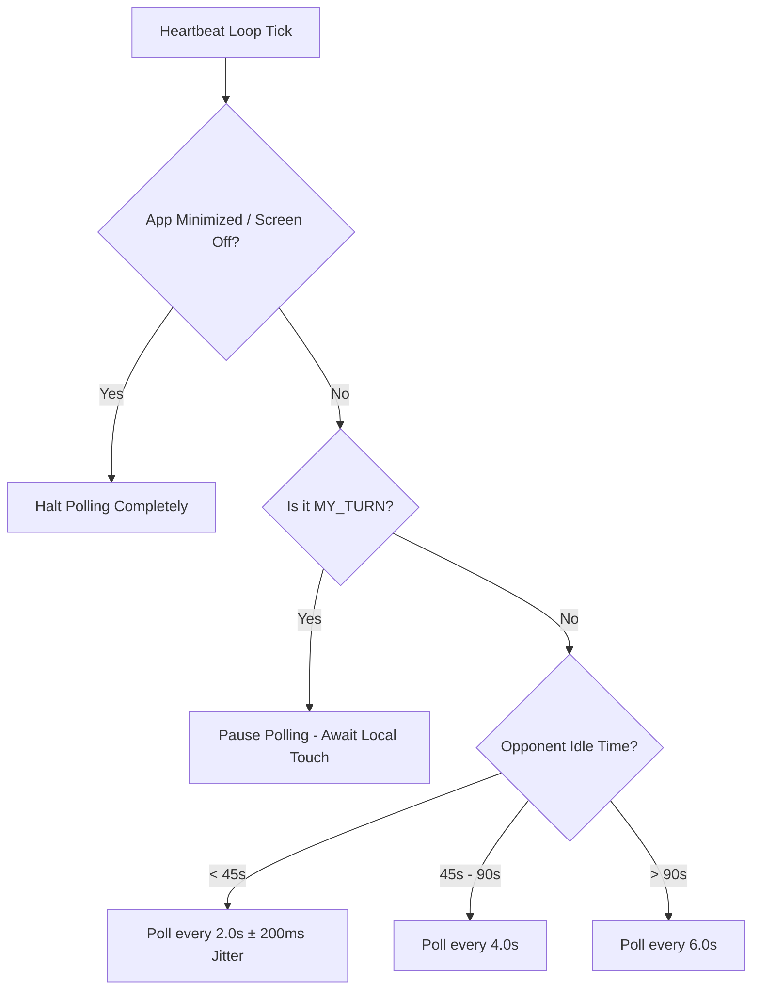

# 🔄 Pookie State Machines & Heartbeat Architecture

**Author:** Soham Dalwadi  
**Role:** Principal Architect  
**Client Framework:** Anti Gravity Engine  

---

## 1. High-Level Lifecycle Flow

The user journey follows a deterministic, state-driven lifecycle:



---

## 2. Adaptive Polling Engine & Quota Protection

Blind interval polling causes two major failures in mobile games with Google Sheets backends:
1. **Google Apps Script Rate Quota Limits:** 1 request every 2s across 2 players = 3,600 calls/hour.
2. **Mobile Battery & CPU Drain:** Continuous network wake-locks keep radio antennas active.

### The 4 Pillars of Pookie Adaptive Polling:



### Polling Implementation Algorithm:
```typescript
class PookieHeartbeatManager {
  private timerId: number | null = null;
  private opponentTurnStartTime: number = 0;

  public onStateChanged(state: ClientRoomState) {
    if (state.currentTurn === state.myRole || state.status !== 'PLAYING') {
      this.stop();
      return;
    }

    // Opponent's turn: initiate adaptive polling
    this.opponentTurnStartTime = Date.now();
    this.scheduleNextTick(2000);
  }

  private async tick() {
    if (document.hidden) {
      // Suspend polling when app is in background
      return;
    }

    const elapsed = Date.now() - this.opponentTurnStartTime;
    const interval = elapsed > 90000 ? 6000 : elapsed > 45000 ? 4000 : 2000;
    const jitter = Math.floor(Math.random() * 400) - 200; // ±200ms

    try {
      const response = await api.getState({
        roomCode: currentRoom.code,
        version: currentRoom.version
      });

      if (response.isUpdated) {
        // Opponent made a move! Apply state and switch turn
        store.applyServerUpdate(response);
        return; // State change will re-evaluate turn
      }
    } catch (err) {
      console.warn("Heartbeat failed, retrying...", err);
    }

    this.scheduleNextTick(Math.max(1500, interval + jitter));
  }

  private scheduleNextTick(ms: number) {
    if (this.timerId) clearTimeout(this.timerId);
    this.timerId = window.setTimeout(() => this.tick(), ms);
  }

  public stop() {
    if (this.timerId) {
      clearTimeout(this.timerId);
      this.timerId = null;
    }
  }
}
```
