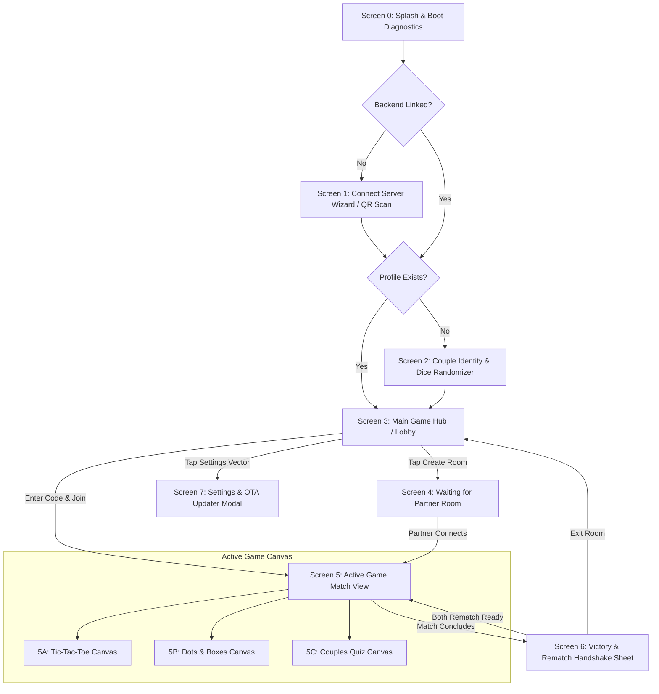

# 🎬 Pookie UI Screen Hierarchy & Motion Transition Architecture

**Author:** Soham Dalwadi  
**Role:** Principal Architect & Product Designer  
**Visual Style:** [Telegram Mini-App / EdChess Aesthetic](https://dribbble.com/shots/24700933-Telegram-Mini-App-UI-UX-New-Design-EdChess)  
**Motion Principles:** 60fps Native Physics • Shared Element Morphing • Zero-Emoji (Vector Only)  

---

## 📌 Executive Summary
A game for couples must feel intimate, tactile, and responsive. Sluggish page reloads or jarring view cuts break the romantic immersion. 

Pookie utilizes a **Single-Activity Architecture** with a deterministic **Navigation Flow Graph**. Every screen transition is choreographed with hardware-accelerated micro-animations, spring curves, and shared element bounds.

---

## 1. Master Screen Flow Graph

---

## 2. Comprehensive Screen Inventory & Wireframes

### Screen 0: Splash & Boot Diagnostics
- **Visuals:** Deep charcoal backdrop with an animated pulsing vector heart outline.
- **Background Tasks:**
  1. Checks if `POOKIE_API_URL` is set in local storage.
  2. Queries `https://api.github.com/repos/sohamdalwadi/Pookie/releases/latest` for OTA updates in background.
- **Transition Out:** Radial scale fade (200ms) into Screen 1 or Screen 3.

---

### Screen 1: Connect Server Wizard (Pre-Compiled APK Onboarding)
- **Visuals:** Minimalist glassmorphic card explaining the zero-cost Google Sheet backend.
- **Components:**
  - Deployment ID / URL text field.
  - Secondary CTA: `[Scan Partner's QR Vector]`.
  - Tutorial Accordion: *"How to deploy backend in 2 minutes (Click to open)"*.
- **Validation:** On tap *"Connect"*, fires `GET ?action=HEALTH_CHECK`.
  - If success: Green checkmark vector springs in; transitions to Screen 2.
  - If fail: Red shake animation on the text field with specific troubleshooting hint.

---

### Screen 2: Couple Identity Onboarding (With Dice Vector Engine)
- **Visuals:** Clean profile card to establish couple nicknames and relation vibe.
- **Key Elements:**
  - **Nickname Input + Isometric Dice Vector:** Tapping the dice triggers a 360° spring-rotation and rolls from a curated nickname bank (*Bubba, Pookie, Sweetpea, Mochi, Honeybun*).
  - **Pronoun Chips:** `He/Him`, `She/Her`, `They/Them`.
  - **Relationship Chips:** `Dating`, `Engaged`, `Married`, `Long-Distance`, `Besties`.
  - **Duration Pills:** `<6m`, `6-12m`, `1-3y`, `3-5y`, `5y+`.
  - **Vibe Tags (Sole Permitted Emoji Zone):** `🍕 Foodies`, `🎮 Gamers`, `🐱 Pet Parents`, `☕ Coffee`, `🛋️ Homebodies`, `🔥 Chaotic`.
- **CTA Transition:** High-contrast Rose-Coral button expands slightly on press (`scale: 0.96 -> 1.0`) and slides up into the Lobby.

---

### Screen 3: Main Game Hub (Lobby)
- **Layout (EdChess Inspired):**
  - **Header:** User Avatar vector, Nickname, Relationship badge, Settings gear vector.
  - **Quick Play Card:**
    - Primary Button: `[+ Create Room Vector]`.
    - 6-Character Room Code input + `[Join Vector]`.
  - **Game Selector Deck:**
    - Card 1: **Tic-Tac-Toe** (Grid vector, "Classic 3x3 • Quick Banter").
    - Card 2: **Dots & Boxes** (Matrix vector, "4x4 Grid • Capture Territory").
    - Card 3: **Couples Icebreaker Quiz** (Brain sparkle vector, "Gemini AI Powered • Blind Reveal").
  - **Bottom Navigation Dock:** Floating glass dock with `Home`, `Games`, `Stats` vectors.

---

### Screen 4: Waiting for Partner Room
- **Visuals:** Focused, suspenseful waiting view.
- **Components:**
  - Giant 6-character room code pill (e.g. `POOK99`) with `[Copy Vector]` button.
  - `[Share QR Code Vector]` button to show partner pairing code on screen.
  - Animated pulsing radar ring vector with text: *"Waiting for your Pookie to join..."*
- **Auto-Transition:** The second the polling heartbeat receives `status: "PLAYING"` and `partner` is non-null, the radar bursts into confetti particles and transitions seamlessly into Screen 5!

---

### Screen 5: In-Game Match Screen (PvP HUD)
- **Top Bar:** Back arrow vector, Room Code, Live Ping Pill (`● Online 95ms`).
- **Split PvP Header:**
  - Left Card: Host (Avatar vector, Name, Score, Turn status).
  - Right Card: Partner (Avatar vector, Name, Score, Turn status).
  - **Active Turn Highlight:** The player whose turn it is gets a radiant Mint Emerald border glow (`box-shadow: 0 0 16px rgba(0, 229, 153, 0.4)`).
- **Game Canvas Variants:**
  - **5A: Tic-Tac-Toe Canvas:**
    - Grid lines are drawn with sharp SVG strokes.
    - Tapping a cell renders a spring-animated `"X"` or `"O"`.
    - Winning combo draws an electric neon strike vector through the 3 cells.
  - **5B: Dots & Boxes Canvas:**
    - 4x4 matrix of glowing circular dots.
    - Hover / touch proximity highlights prospective edges with a soft dashed vector line.
    - Claimed edge snaps into a solid neon bar.
    - Completed box triggers an interior fill pulse with the capturing player's initial (`H` or `P`) and awards an extra turn sound/haptic!
  - **5C: Couples Quiz Canvas:**
    - Clean card containing the question prompt.
    - 4 answer tiles. Tapping one locks it in with a border glow.
    - Opponent's card shows a subtle glowing *"Partner is thinking..."* spinner. When they answer, it switches to *"Partner has locked in!"* (answer masked).
    - Once both submit: Cards execute a simultaneous 3D flip reveal with celebratory heart confetti!

---

### Screen 6: Game Over & Rematch Negotiation Bottom Sheet
- **Presentation:** A glassmorphic bottom sheet that slides up over the dimmed game canvas.
- **Components:**
  - Result Banner: *"Bubba Wins!"* or *"It's a Draw!"*.
  - Scoreboard tally update with animated number increments (`+1`).
  - Dual Handshake Rematch Indicator:
    - Host button: `[ Rematch Ready (Vector) ]`
    - Partner button status: `[ ○ Waiting for Partner ]`
  - When both tap rematch: Both buttons light up green, the sheet collapses down, and the board resets instantly!

---

### Screen 7: Settings & OTA Updater Modal
- **Components:**
  - Profile editor (re-roll nickname with dice, update vibe tags).
  - Backend Server Config (shows current Web App URL, `[Test Connection Vector]`, `[Share QR Vector]`).
  - GitHub OTA Update Card:
    - Displays current version: `v1.0.0`.
    - Button: `[Check for Updates Vector]`.
    - If newer tag exists: Expands changelog and displays `[Download & Install Update Vector]`.

---

## 3. Motion Choreography & Transition Matrix

| From Screen | To Screen | Trigger | Transition Type | Duration | Easing Curve |
| :--- | :--- | :--- | :--- | :---: | :--- |
| **Screen 1 (Setup)** | **Screen 2 (Profile)** | Backend Verified | Slide Left + Fade | 280ms | `cubic-bezier(0.16, 1, 0.3, 1)` |
| **Screen 2 (Profile)** | **Screen 3 (Lobby)** | Tap "Enter Lobby" | Shared Element Morph | 320ms | `cubic-bezier(0.34, 1.56, 0.64, 1)` (Spring) |
| **Screen 3 (Lobby)** | **Screen 4 (Wait Room)** | Tap "Create Room" | Push Slide Right | 250ms | `cubic-bezier(0.2, 0, 0, 1)` |
| **Screen 4 (Wait Room)** | **Screen 5 (Game)** | Partner Joined | Radial Burst & Zoom | 350ms | `cubic-bezier(0.34, 1.56, 0.64, 1)` |
| **Screen 5 (Game)** | **Screen 6 (Game Over)** | Board Terminal | Bottom Sheet Slide Up | 300ms | `cubic-bezier(0.32, 0.72, 0, 1)` |
| **Screen 6 (Game Over)** | **Screen 5 (Game)** | Both Rematch Ready | Sheet Slide Down | 220ms | `ease-in` |
| **Screen 5 (Game)** | **Screen 3 (Lobby)** | Tap Back Arrow | Slide Left Pop | 240ms | `cubic-bezier(0.2, 0, 0, 1)` |

---

## 4. Tactile Haptic & Audio Feedback Specs

Pookie pairs visual transitions with subtle Android haptic feedback:

| Action | Haptic Effect | Audio Sound Effect |
| :--- | :--- | :--- |
| **Dice Randomizer Roll** | `HapticFeedbackConstants.KEYBOARD_TAP` (Rapid click ticks) | Crisp mechanical dice rattle |
| **Place X / O Mark** | `HapticFeedbackConstants.CONTEXT_CLICK` | Soft wooden piece tap |
| **Complete a Box (Dots & Boxes)** | `HapticFeedbackConstants.CONFIRM` (Double pulse) | High-pitched pleasant chime |
| **Quiz Answer Submitted** | `HapticFeedbackConstants.CLOCK_TICK` | Subtle card flick sound |
| **Quiz Answers Match (Soulmate!)** | `HapticFeedbackConstants.LONG_PRESS` (Warm rumble) | Celebratory harp chime |
| **Opponent Move Arrives** | `HapticFeedbackConstants.VIRTUAL_KEY` | Gentle droplet ping |
