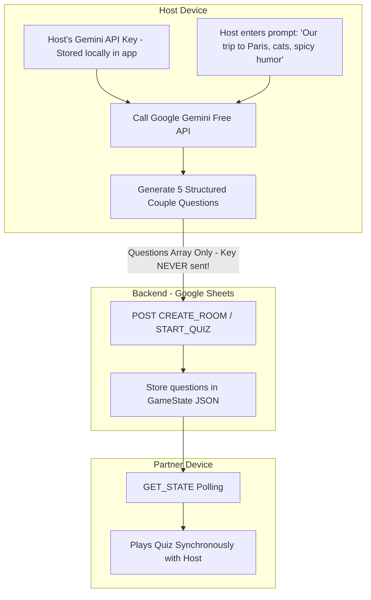

# 🤖 AI-Powered Couples Quiz (Google Gemini Free Tier Integration)

**Author:** Soham Dalwadi  
**Role:** Principal Architect  
**Model:** Google Gemini (Free Tier: `gemini-1.5-flash` or `gemini-2.5-flash`)  

---

## 📌 The Question: Can a Single Side API Key Handle the Whole Room?

> **Verdict: YES, absolutely.** In fact, having **only ONE person** (the Host) provide the API key is by far the superior user experience and architecture.

### Why Single-Side Key Architecture is Best:
1. **Zero Friction for Partner:** Asking both partners to go to Google AI Studio, create a Google Cloud project, and copy-paste an API key kills the romantic mood. One partner sets it up once, and both enjoy the magic.
2. **Deterministic Synchronization:** If both devices called AI independently, they would generate different questions! By having a single source of generation, both partners receive the exact same synchronized questions.
3. **Zero Cost (Free Tier):** Google Gemini offers a generous free tier (15 Requests Per Minute, 1,500 Requests Per Day), which is more than 100x what a couple needs for a gaming session.

---

## 🏗️ Architecture Comparison: Client-Side Host Generation vs Server-Side



### Why **Client-Side Host Generation** is the Winner:
1. **Absolute Security:** The Gemini API key **never leaves the Host's phone**. It is never sent over the network to Google Apps Script or stored in Google Sheets.
2. **Zero Backend Changes Needed:** The Google Apps Script backend doesn't need external network fetch permissions. It simply stores the questions array inside the existing `GameState` JSON string.
3. **Graceful Fallback:** If the Host doesn't have an API key, the game automatically falls back to the static `QuizQuestions` sheet.

---

## 📐 End-to-End Workflow

### Step 1: Host Enters Topic & Optional API Key
In the app's settings or before starting the Quiz:
- **API Key:** Host enters their free Gemini API Key (saved securely in device storage).
- **Personalized Vibe / Topic (Optional):**
  - *"We have been dating for 2 years, love sushi, inside jokes about being messy, and dream of buying a camper van."*

---

### Step 2: Structured Prompt Sent to Gemini
The app calls `https://generativelanguage.googleapis.com/v1beta/models/gemini-1.5-flash:generateContent?key={API_KEY}` with a strict JSON schema prompt:

```json
{
  "contents": [{
    "parts": [{
      "text": "You are a warm, witty couples game master. Generate 5 delightful multiple-choice questions for a couple with this vibe: 'Dating 2 years, love sushi, playful banter about who is messier'. Return ONLY a JSON array with this exact structure: [{\"questionId\":\"AI_1\",\"category\":\"PLAYFUL\",\"questionText\":\"Who is guilty of hoarding empty snack boxes?\",\"optionA\":\"Definitely me\",\"optionB\":\"100% them\",\"optionC\":\"The cat did it\",\"optionD\":\"We are equally guilty\"}]."
    }]
  }],
  "generationConfig": {
    "responseMimeType": "application/json"
  }
}
```

---

### Step 3: Pushing Questions to the Room Session
The Host's client parses the AI response and sends it to the server in `CREATE_ROOM` or `START_QUIZ`:

```json
{
  "action": "START_QUIZ",
  "payload": {
    "roomCode": "POOK99",
    "playerId": "c3f912e6-8c43-4b61-9c12-32f281e0129a",
    "isAiGenerated": true,
    "questions": [
      {
        "questionId": "AI_1",
        "category": "PLAYFUL",
        "questionText": "Who is guilty of hoarding empty snack boxes?",
        "options": {
          "A": "Definitely me",
          "B": "100% them",
          "C": "The cat did it",
          "D": "We are equally guilty"
        }
      }
    ]
  }
}
```

---

### Step 4: Synchronized Blind Play & Reveal
1. Both Host and Partner receive the AI questions via the standard room state.
2. Partner answers on their phone.
3. Host answers on their phone.
4. Neither sees the other's answer until both have answered, triggering the synchronous flip & celebration!

---

## 🛡️ Edge Cases & Safety Guards

| Edge Case | Solution |
| :--- | :--- |
| **Host does not have a Gemini API key** | The app falls back automatically to the curated static `QuizQuestions` sheet. |
| **Gemini Free Tier rate-limit (HTTP 429)** | The client detects 429 and shows: *"AI is catching its breath! Falling back to classic curated questions."* |
| **Partner wants to provide the key instead** | Either player can be the *"Quiz Master"* who initiates the AI round. |
| **Inappropriate / offensive output** | Gemini's default safety filters are enabled; client validates that output fits the standard 4-option schema. |
